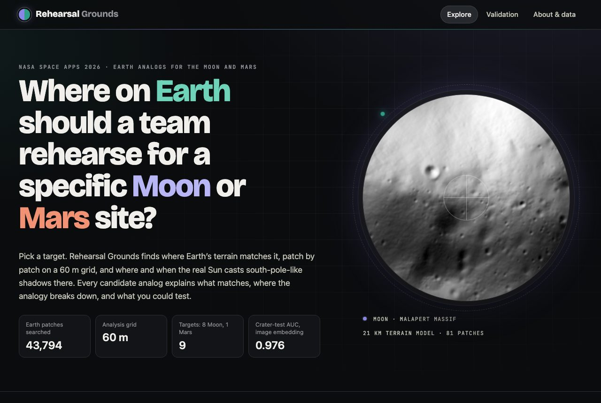
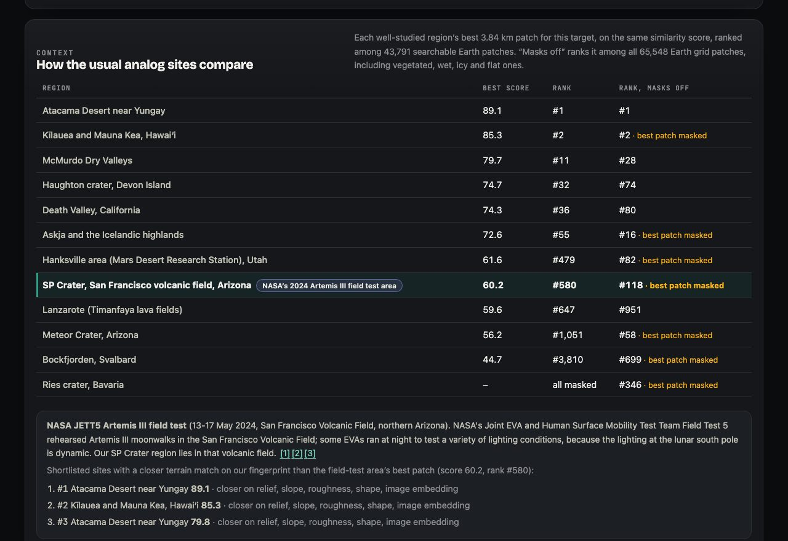
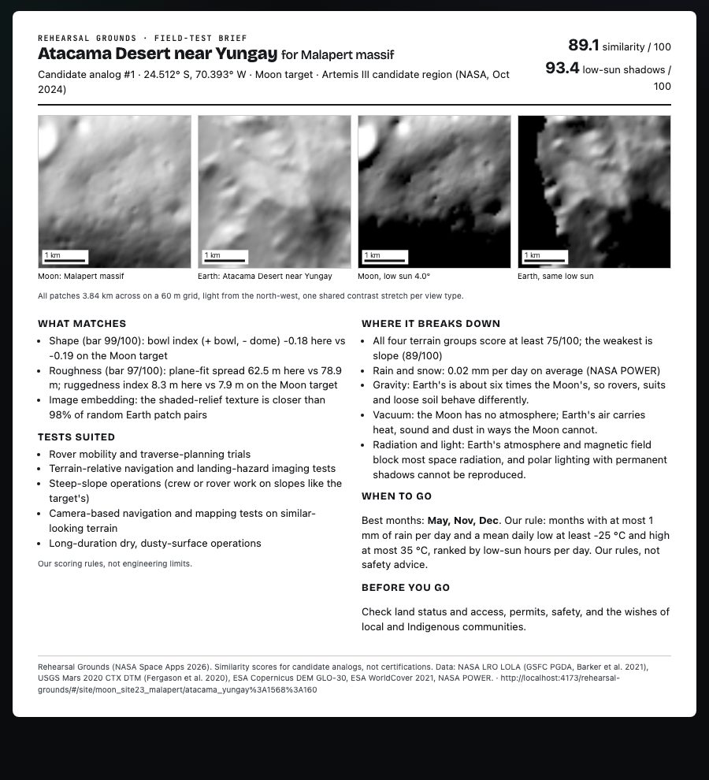

# Rehearsal Grounds

In May 2024 NASA's JETT5 field test rehearsed Artemis III moonwalks in Arizona's San Francisco Volcanic Field, and
ran some of them at night to test a variety of lighting conditions, because the lighting at the lunar south pole is
dynamic ([USGS](https://www.usgs.gov/centers/astrogeology-science-center/news/artemis-iii-mission-tests-san-francisco-volcanic-field), [NASA](https://svs.gsfc.nasa.gov/14583)). Rehearsal Grounds answers two questions for an
analog field-test planner: **where on Earth does the terrain match a specific Artemis III or Mars site**, patch by
patch at 60 m, and **where and when does the real Sun cast south-pole-like shadows there?**

For each target (8 LOLA south-pole sites, 4 of them NASA Artemis III candidate regions, and the Jezero landing area
on Mars) it ranks 43,794 Earth patches. Every candidate analog gets a dossier: a swipe comparison of the two terrains,
including a low-Sun view with cast shadows, what matches, where the analogy breaks down, a lighting similarity, a
12-month rehearsal calendar with suggested months, whether it is near a known analog, and which tests it suits.

**Live app:** https://iammanoj807.github.io/rehearsal-grounds/ · 2026 NASA Space Apps Challenge, *Identify Earth
Locations that Analog the Permanent Moon Base Locations and Mars*.







## How it works

1. **Real terrain models.** NASA LRO LOLA 5 m/pix site DEMs for eight lunar south-pole sites (Malapert massif,
   Shackleton rim, Connecting ridge, de Gerlache rim, Leibnitz beta plateau, Haworth, Nobile rim 1, Nobile rim 2),
   the USGS Mars 2020 CTX DTM of the Jezero landing area, and ESA Copernicus DEM GLO-30 for 30 Earth regions: 12
   well-studied analogs, 12 discovery candidates and 6 crater benchmark tiles. Four targets carry the name of one of
   [NASA's nine Artemis III candidate regions](https://www.nasa.gov/news-release/nasa-provides-update-on-artemis-iii-moon-landing-regions/)
   (Haworth, Malapert Massif, Nobile Rim 1, Nobile Rim 2); Site11 "de Gerlache rim" is left unlabelled because it
   may not be NASA's "de Gerlache Rim 2".
2. **One common grid.** Everything is resampled to 60 m: Earth to local UTM, the Moon in its polar stereographic
   metres, and Mars warped from equirectangular to an azimuthal equidistant projection centred on Jezero (otherwise
   east-west slopes at 18° N are stretched by 5%). The grids are cut into 64 × 64 px (3.84 km) patches with 50%
   overlap: 65,555 on Earth, 831 on the nine targets.
3. **Terrain fingerprint.** 20 rotation-invariant features a geologist can read: relief, hypsometric integral,
   slope statistics and histogram at 60 m and 120 m, roughness, ruggedness, curvature and a bowl-versus-dome
   index. A pretrained ResNet-18 adds a 64-d image embedding of each patch (hillshade, slope and detrended height
   channels). No model is trained.
4. **Search.** Earth patches with more than 20% trees, cropland, buildings, wetland or mangrove (ESA WorldCover)
   are excluded; shrub, grass and moss count too where NASA POWER gives more than 500 mm of rain a year, the upper
   bound of semiarid land in the [USGS desert primer](https://pubs.usgs.gov/gip/deserts/what/), because in drier
   places that class is mostly bare ground between scattered plants. Patches with more than 5% water, more than 50%
   snow and ice, or under 5 m of relief are also excluded, which leaves 43,794 candidates. Every candidate is scored against every target
   patch:
   `S = 100 × (0.6 · exp(−d² / 2σ²) + 0.4 · (1 + cos) / 2)`, where d is the fingerprint distance with equal weight
   per feature group, and σ is the median distance from the target's patches to their nearest Earth patch. Sites are
   kept at least 10 km apart.
5. **Explain.** Explanation bars give each feature group's closeness as a percentile against random Earth patch
   pairs. The dossier adds NASA POWER climate, WorldCover land cover within 2 km, a novelty flag and rule-based
   "tests suited" lines. The flag reads "Near a known analog" when the site is within 50 km of a catalogue entry
   (24 analog and astronaut-training sites, each with a source) or inside a well-studied analog region, and
   "Outside our analog catalogue" otherwise. Antarctica has no WorldCover tiles, so McMurdo sites stay in the
   search and their dossiers warn that the patch may be glacier ice.
6. **How the usual sites compare.** For each target, each well-studied region's best patch is ranked on the same
   score, with and without the land-cover masks. The SP Crater region lies in the San Francisco Volcanic Field where
   JETT5 ran; for the eight Moon targets its best searchable patch ranks between #251 and #1,288, and its best patch
   overall is one the masks remove (with masks off it ranks between #104 and #330). For Jezero it ranks #19.
7. **Low-sun lighting analog.** At the lunar south pole the noon Sun stays within 1.54° of 90° − |latitude| all
   year: 0–1.8° at Shackleton rim, 2.5–5.6° at Malapert. For both the target patch and the Earth patch we march rays
   toward the Sun from 36 directions across 3.84 km of surrounding terrain, include the body's curvature (d²/2R), and
   count the share of the patch in cast or attached shadow at 1, 2, 3, 5 and 10°. The Earth patch is given the same
   visible surroundings as its target patch, because the LOLA site maps are small. Lighting similarity = 100 × (1 −
   mean difference) at the elevations inside the target's band. It is a separate panel and never changes the
   similarity score. Medians are 92–95 across the Moon targets.
8. **Rehearsal window.** For every Earth site: daylight and low-sun hours on the 15th of each month (NOAA
   solar-position equations), NASA POWER monthly temperature and rain, and up to three suggested months from a
   stated rule (config/rehearsal.yaml): dry months (≤ 1 mm/day) with a mean daily low of at least −25 °C and high of
   at most 35 °C, ranked by low-sun hours. Planner outputs: CSV, GeoJSON and KML of the shortlist, a printable
   field-test brief per site, and a "Before you go" box with sourced notes where an official source exists.

## Validation

All numbers are read from [`web/public/data/validation.json`](web/public/data/validation.json), written by
`pipeline/10_validate.py`. Nothing is edited by hand.

**V1, crater retrieval (headline).** Seven PASSC impact craters 0.8–3.5 km across, exposed and younger than 10 Ma.
Each crater-centred patch is used as a query against 65,407 regular grid patches from the other regions. A hit is a
patch whose window fully contains another crater. Hard negatives are only the non-crater patches of the other
crater tiles (about 6,500 per query): non-crater terrain from the same landscapes as the other benchmark craters.

| Ranker | Mean ROC AUC | AUC, hard negatives | Mean reciprocal rank | Hit rate @10 |
| --- | --- | --- | --- | --- |
| Random | 0.546 | 0.546 | 0.000 | 0% |
| Relief only | 0.629 | 0.524 | 0.004 | 0% |
| Terrain features only | 0.632 | 0.542 | 0.000 | 0% |
| **Image embedding only** | **0.976** | **0.976** | **0.656** | **86%** |
| Combined, Earth-to-Earth σ (0.16) | 0.976 | 0.974 | 0.387 | 71% |
| Combined, Moon-target σ (0.68) | 0.889 | 0.848 | 0.023 | 14% |

The finding: at 60 m the readable terrain features alone recognise 1–3 km craters only weakly, while the image
embedding does much better, also against hard negatives, so it recognises the craters themselves, not just the
landscapes around them. The
Earth-to-Earth combined row tracks the embedding because its σ drives the terrain term to near zero. At the Moon
targets' σ (median 0.68, the closer match to how the app ranks Moon targets) the combined score still separates
craters from other terrain (AUC 0.889), but another crater reaches the top 10 for only 14% of queries: patches with
similar slope and
relief compete with them. The app keeps 60% terrain features because they carry the slope, relief and roughness
values operations planning needs, and the 0.6/0.4 split was set before this benchmark existed; changing it now
would tune the method on its own test set. An earlier version of the test leaked: crater-centred patches were also
the answers. The Validation page documents that fix.

**V2, rediscovery.** The median well-studied region's best patch ranks in the top 0.7% for every target, and the
median discovery region's in the top 1.5%, so this measure does not separate the two sets. It is reported as
context only.

**V3, robustness.** The 90 m rerun gives Spearman ρ between 0.74 (Jezero) and 0.97 (Connecting ridge) for the
top-20 regions of the nine targets. With ±20% feature-group weight perturbations, 86–99% of top-10 sites stay in
the top 10. The terrain/embedding split matters more: at 0.4/0.6, 50–80% of each target's top 10 stays, and at
0.8/0.2, 60–100%.

**Lighting checks.** All four pass: a flat plane casts no shadow at a 1° Sun; a 100 m step casts a shadow of
h / tan(e) within one 60 m pixel (9 px against 9.45 expected at 10°); the lunar curvature drop at 10 km is 28.78 m;
and the solar elevation matches the published NREL SPA example (39.872° true against 39.888° apparent).

**V4, sanity checks.** All four pass: self-match = 100, 90° rotation keeps its own top match, flat plane = slope 0,
gradient 0.1 = 5.71°.

## Quick start

```bash
make setup                # Python 3.11 venv (uv) + web dependencies
make pipeline-small       # 1 target, 2 regions, under a minute; writes data/small/export
make pipeline             # full run: downloads ~0.9 GB, about 10 minutes on a laptop
make test                 # 48 unit tests
cd web && npm run dev     # app on http://localhost:5173/rehearsal-grounds/
```

The web app only reads the static files in `web/public/data/`. There is no server.

## Pipeline

| Step | Script | Output |
| --- | --- | --- |
| 01 | `01_fetch_targets.py` | LOLA and CTX GeoTIFFs in `data/raw/targets/` |
| 02 | `02_fetch_earth.py` | Copernicus DEM + WorldCover windows per region (COGs over HTTPS) |
| 03 | `03_reproject.py` | 60 m metric grids (UTM, polar stereographic, Mars azimuthal equidistant) |
| 04 | `04_patches.py` | 3.84 km patches, land-cover shares, overlap de-duplication |
| 05 | `05_features.py` | `features.parquet` (20 features per patch) |
| 06 | `06_embed.py` | ResNet-18 embeddings → PCA 64-d (target rotations included) |
| 07 | `07_index.py` | robust scaling, FAISS index, σ and percentile calibration |
| 08 | `08_query.py` | top-50 sites per target after 10 km non-maximum suppression |
| 08b | `08b_usual_sites.py` | each well-studied region's best patch per target, masks on and off; the JETT5 comparison |
| 09 | `09_environment.py` | NASA POWER climate, WorldCover 2 km shares, novelty |
| 09b | `09b_lighting.py` | Sun band, shadow fingerprints, lighting similarity, low-sun previews, monthly Sun hours, suggested months |
| 10 | `10_validate.py` | `validation.json` (V1–V4) |
| 11 | `11_export.py` | JSON + hillshade PNGs validated against `pipeline/schemas.py` |

Configuration lives in `config/`: `pipeline.yaml`, plus regions, targets, craters, known analogs, the tests-suited
rules, `lighting.yaml` and `rehearsal.yaml`, each entry with its source URL or marked as our choice.
`scripts/regression_guard.py` compares every target's top 20 with a saved export after any pipeline change.

## Data sources and licences

LOLA site DEMs (NASA GSFC PGDA; Barker et al. 2021), Mars 2020 TRN CTX DTM (USGS, CC0; Fergason et al. 2020),
Copernicus DEM GLO-30 (ESA/EU), ESA WorldCover 2021 (CC-BY 4.0), NASA POWER, NASA GIBS (Blue Marble and Landsat
WELD tiles), the PASSC Earth Impact Database (read from Internet Archive snapshots, because passc.net is offline),
Wikipedia and PANGAEA coordinates. See [`DATA_LICENSES.md`](DATA_LICENSES.md) for the attribution text and
[`data/SOURCES.md`](data/SOURCES.md) for every downloaded file with URL and date.

## Limits

- Earth cannot reproduce lunar or martian gravity, vacuum or thin CO₂ air, radiation, regolith or polar lighting.
- A 60 m grid cannot see boulders or small craters. The LOLA site maps are largely interpolated between laser tracks.
- Copernicus DEM is a surface model, so vegetation and lakes distort it. Land-cover masks remove the worst cases.
- The steepest target slopes have no close Earth match. Earth has a close terrain match for 56% of Malapert's
  and Nobile rim 1's patches and 69% of Shackleton rim's (86–100% for the other six targets). The unmatched patches are the steep,
  high-relief ones: for Malapert, their median 90th-percentile slope is 26.9° and relief 1,493 m, against 21.1° and
  877 m for the matched patches. For Shackleton rim the figures are 32.4° and 2,139 m against 25.9° and 859 m.
- WorldCover labels sparse desert scrub as shrub or grass. Below 500 mm of rain a year it is not masked, so some
  dry sites show high "shrub, grass or moss" shares; their dossiers say it is sparse dryland cover. Wetter regions
  such as Ries and Wolfe Creek (606 mm/yr on the POWER grid) keep no searchable patches.
- Antarctica has no land-cover data, so McMurdo patches are not masked. McMurdo holds 17 of the 90 top-10 places
  across the nine targets; each of those dossiers warns that the patch may be glacier ice.
- Lighting: shadows on a 60 m grid miss boulders and small craters; no atmosphere scattering, regolith reflectance
  or Earthshine; at 1–2° most rough terrain is largely in shadow on both bodies, so lighting scores bunch near the
  top (medians 92–95). Sun hours use the true Sun; refraction lifts the apparent low Sun (NOAA assumes 0.833° at
  sunrise and sunset).
- The novelty catalogue is a set of 24 points, not a complete census of analog research. "Outside our analog
  catalogue" means only that: the site may still have been studied.
- Crater benchmark: seven craters, so the metrics carry wide uncertainty.

## Licence

Code: MIT (see `LICENSE`). Data: see `DATA_LICENSES.md`.
