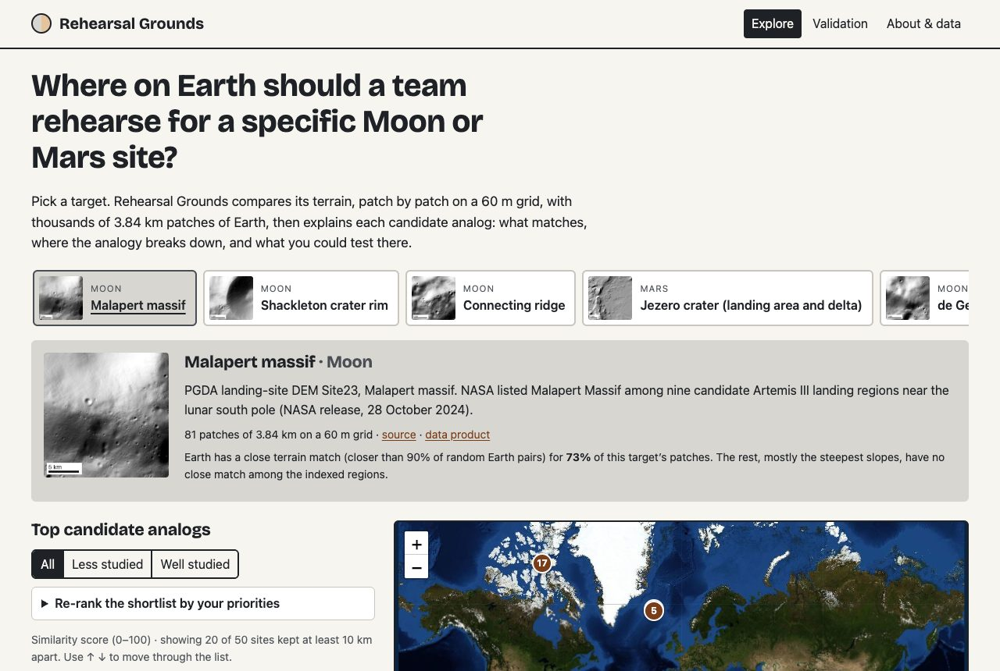
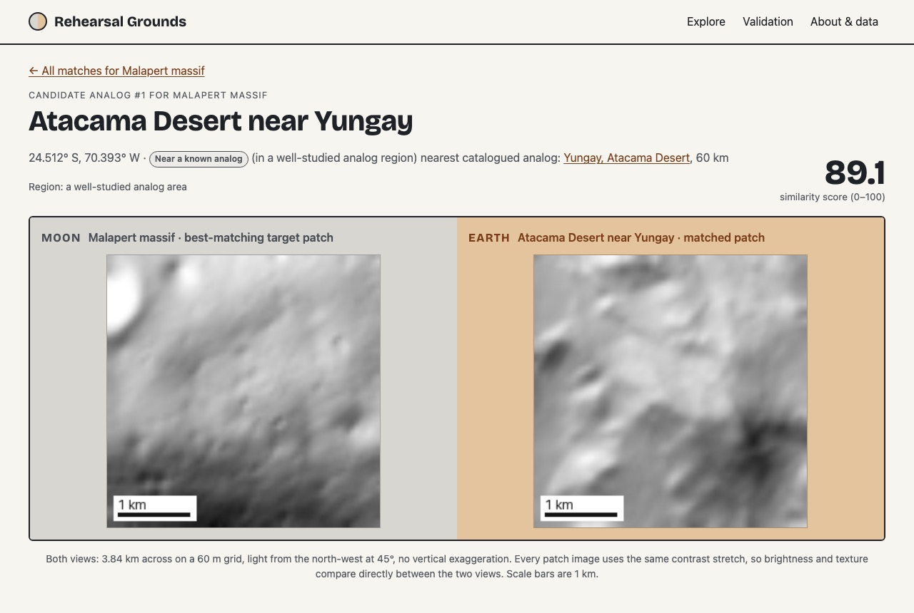

# Rehearsal Grounds

**Where on Earth should a team rehearse for a specific Moon or Mars site?** Rehearsal Grounds matches terrain at the
scale of a crater rim, ridge or lava field (a 60 m grid, 3.84 km patches), not at the scale of a whole region. For
each named target, such as the Malapert massif near the lunar south pole or the Jezero crater landing area on Mars, it
ranks thousands of Earth patches. Each candidate analog then gets a dossier: the two terrains side by side, what
matches, where the analogy breaks down, its climate, how well studied it is, and which tests it suits.

**Live app:** https://iammanoj807.github.io/rehearsal-grounds/ · 2026 NASA Space Apps Challenge, *Identify Earth
Locations that Analog the Permanent Moon Base Locations and Mars*.




## How it works

1. **Real terrain models.** NASA LRO LOLA 5 m/pix site DEMs for five lunar south-pole sites (Malapert massif,
   Shackleton rim, Connecting ridge, de Gerlache rim, Leibnitz beta plateau), the USGS Mars 2020 CTX DTM of the Jezero landing area, and ESA Copernicus DEM
   GLO-30 for 30 Earth regions: 12 well-studied analogs, 12 less-studied candidates and 6 crater benchmark tiles.
2. **One common grid.** Everything is resampled to 60 m: Earth to local UTM, the Moon in its polar stereographic
   metres, and Mars warped from equirectangular to an azimuthal equidistant projection centred on Jezero (otherwise
   east-west slopes at 18° N are stretched by 5%). The grids are cut into 64 × 64 px (3.84 km) patches with 50%
   overlap: 65,555 on Earth, 473 on the six targets.
3. **Terrain fingerprint.** 20 rotation-invariant features a geologist can read: relief, hypsometric integral,
   slope statistics and histogram at 60 m and 120 m, roughness, ruggedness, curvature and a bowl-versus-dome
   index. A pretrained ResNet-18 adds a 64-d image embedding of each patch (hillshade, slope and detrended height
   channels). No model is trained and no language model is used in scoring.
4. **Search.** Earth patches with more than 20% trees, crops or buildings (ESA WorldCover), more than 5% water, or
   under 5 m of relief are excluded, which leaves 49,147 candidates. Every candidate is scored against every target
   patch:
   `S = 100 × (0.6 · exp(−d² / 2σ²) + 0.4 · (1 + cos) / 2)`, where d is the fingerprint distance with equal weight
   per feature group, and σ is the median distance from the target's patches to their nearest Earth patch. Sites are
   kept at least 10 km apart.
5. **Explain.** Explanation bars give each feature group's closeness as a percentile against random Earth patch
   pairs. The dossier adds NASA POWER climate, WorldCover land cover within 2 km, a novelty flag (distance to a
   catalogue of 21 known analog and astronaut-training sites) and rule-based "tests suited" lines.

## Validation

All numbers are read from [`web/public/data/validation.json`](web/public/data/validation.json), written by
`pipeline/10_validate.py`. Nothing is edited by hand.

**V1, crater retrieval (headline).** Seven PASSC impact craters 0.8–3.5 km across, exposed and younger than 10 Ma.
Each crater-centred patch is used as a query against 65,407 regular grid patches from the other regions. A hit is a
patch whose window fully contains another crater.

| Ranker | Mean ROC AUC | Mean reciprocal rank | Hit rate @10 |
| --- | --- | --- | --- |
| Random | 0.546 | 0.000 | 0% |
| Relief only | 0.629 | 0.004 | 0% |
| Terrain features only | 0.632 | 0.000 | 0% |
| Image embedding only | 0.976 | 0.656 | 86% |
| Combined (Earth-to-Earth σ) | 0.976 | 0.387 | 71% |

The finding: at 60 m the readable terrain features alone recognise 1–3 km craters only weakly, while the image
embedding does much better. The app uses both: the features explain a match in physical units, and the embedding
ranks landform shape. An earlier version of the test leaked: crater-centred patches were also the answers. The
Validation page documents that fix.

**V2, rediscovery.** Known analog regions rank in the top 1% for every target, but so do the discovery regions, so
this measure does not separate the two sets. It is reported as context only.

**V3, robustness.** The 90 m rerun gives Spearman ρ between 0.74 (Jezero) and 0.94 (Connecting ridge) for the
top-20 regions of the six targets. With ±20% feature-group weight perturbations, 90–97% of top-10 sites stay in
the top 10.

**V4, sanity checks.** All four pass: self-match = 100, 90° rotation keeps its own top match, flat plane = slope 0,
gradient 0.1 = 5.71°.

## Quick start

```bash
make setup                # Python 3.11 venv (uv) + web dependencies
make pipeline-small       # 1 target, 2 regions, under a minute; writes data/small/export
make pipeline             # full run: downloads ~0.9 GB, about 10 minutes on a laptop
make test                 # 26 unit tests
cd web && npm run dev     # app on http://localhost:5173/rehearsal-grounds/
```

The web app only reads the static files in `web/public/data/`. There is no server.

## Pipeline

| Step | Script | Output |
| --- | --- | --- |
| 01 | `01_fetch_targets.py` | LOLA and CTX GeoTIFFs in `data/raw/targets/` |
| 02 | `02_fetch_earth.py` | Copernicus DEM + WorldCover windows per region (COGs over HTTPS) |
| 03 | `03_reproject.py` | 60 m metric grids (UTM, polar stereographic, Mars azimuthal equidistant) |
| 04 | `04_patches.py` | 3.84 km patches, land-cover shares, overlap de-duplication |
| 05 | `05_features.py` | `features.parquet` (20 features per patch) |
| 06 | `06_embed.py` | ResNet-18 embeddings → PCA 64-d (target rotations included) |
| 07 | `07_index.py` | robust scaling, FAISS index, σ and percentile calibration |
| 08 | `08_query.py` | top-50 sites per target after 10 km non-maximum suppression |
| 09 | `09_environment.py` | NASA POWER climate, WorldCover 2 km shares, novelty |
| 10 | `10_validate.py` | `validation.json` (V1–V4) |
| 11 | `11_export.py` | JSON + hillshade PNGs validated against `pipeline/schemas.py` |

Configuration lives in `config/`: `pipeline.yaml`, plus regions, targets, craters, known analogs and the tests-suited
rules, each entry with its source URL.

## Data sources and licences

LOLA site DEMs (NASA GSFC PGDA; Barker et al. 2021), Mars 2020 TRN CTX DTM (USGS, CC0; Fergason et al. 2020),
Copernicus DEM GLO-30 (ESA/EU), ESA WorldCover 2021 (CC-BY 4.0), NASA POWER, NASA GIBS (Blue Marble and Landsat
WELD tiles), the PASSC Earth Impact Database (read from Internet Archive snapshots, because passc.net is offline),
Wikipedia and PANGAEA coordinates. See [`DATA_LICENSES.md`](DATA_LICENSES.md) for the attribution text and
[`data/SOURCES.md`](data/SOURCES.md) for every downloaded file with URL and date.

## Limits

- Earth cannot reproduce lunar or martian gravity, vacuum or thin CO₂ air, radiation, regolith or polar lighting.
- A 60 m grid cannot see boulders or small craters. The LOLA site maps are largely interpolated between laser tracks.
- Copernicus DEM is a surface model, so vegetation and lakes distort it. Land-cover masks remove the worst cases.
- The steepest target slopes have no close Earth match. Earth has a close terrain match for 73% of Malapert's
  patches and 69% of Shackleton rim's (96–100% for the other four targets). The unmatched patches are the steep,
  high-relief ones: for Malapert, their median 90th-percentile slope is 27.7° and relief 1,622 m, against 21.8° and
  1,030 m for the matched patches. For Shackleton rim the figures are 32.4° and 2,139 m against 25.9° and 859 m.
- The novelty catalogue is a set of points (21 sites), not a complete census of analog research.
- Crater benchmark: seven craters, so the metrics carry wide uncertainty.

## Use of AI

We used an AI coding assistant to help write the code and documentation, under our direction and review. All data,
results and scores come from the open datasets listed and our own pipeline runs.

## Licence

Code: MIT (see `LICENSE`). Data: see `DATA_LICENSES.md`.
